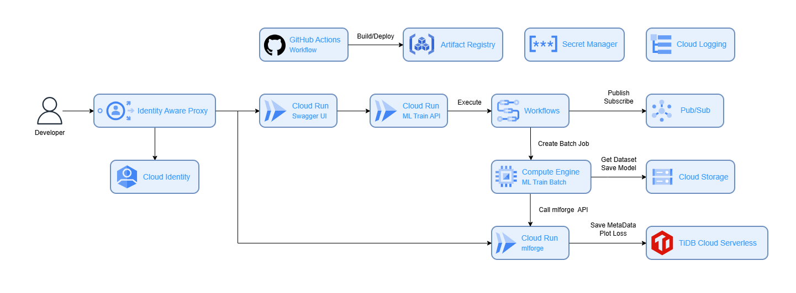

# MACH MLOps (App)

This is the project for building the [MACH MLOps](https://github.com/O01o/mach_mlops) boiler plate application.  

## Installation

Please fork and clone this repository.  

## Usage

### Required CLIs

Please complete this setup if you haven't finished installing below yet.  
- [Google Cloud CLI](https://cloud.google.com/cli)
- [Docker CLI](https://docs.docker.com/engine/install/)
- [Go Language](https://go.dev/doc/install)

### Google Cloud Project

Please create your Google Cloud account and project if you haven't setup. Do not use an existing project, please create new one.  
If you want to organize and manage your projects in a hierarchical directory structure, you may need to register a domain before. I recommend to utilize [Cloudflare DNS](https://www.cloudflare.com/ja-jp/application-services/products/dns/).  

### Setting Secrets and Variables on GitHub Actions

And before you build resources with Terraform, fyou need to set secrets on Google Cloud Secret Manager.  
This is managed by a project-by-project basis.  
These are the secrets you need.  

- secrets
  - GCLOUD_LOCATION
  - GCLOUD_PROJECT_ID
  - WIF_PROVIDER
- variables
  - WIF_SA
  - SWAGGER_ARTIFACT_REPO
  - SWAGGER_SERVICE_NAME
  - SWAGGER_CLOUD_RUN_SA
  - API_ARTIFACT_REPO
  - API_SERVICE_NAME
  - API_CLOUD_RUN_SA
  - BATCH_ARTIFACT_REPO
  - BATCH_JOB_NAME
  - BATCH_CLOUD_RUN_SA

### Custom Your Application

#### REST API as Training Parameters

According to the README of MACH MLOps, you run a training batch with training parameters via REST API and Swagger UI.  

So, if you custom training parameters, there are two points to fix.  

- OpenAPI YAML in swagger
- Request Body Schema in api

#### Implementing Training Batch

Although it is complecated to understand it, there are two locations of batches, `/batch/*` and `/api/cmd/batch`.  
`/batch/*` is the working directory of implementing training batches, and `/api/cmd/batch` becomes the entrypoint of Google Cloud Batch.  

### Deploy Application

Only to push main branch, 

### Checking

#### Authentication on Cloud Identity

#### Send Request via Swagger UI

